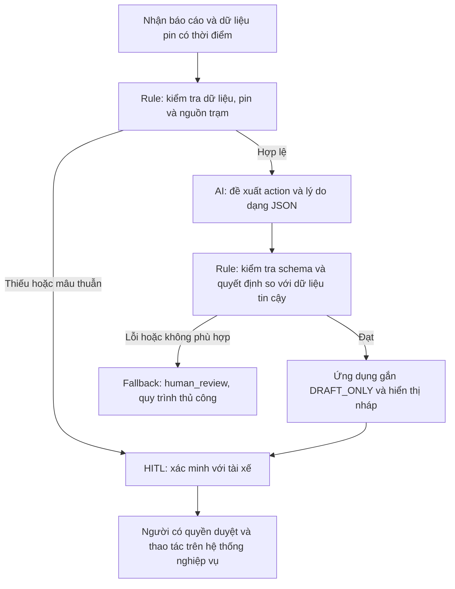

# 02. Deep-Dive Report — Xanh SM Charging Co-pilot

**Tên nhóm:** ManchesterUnited  
**Thành viên:** Nguyễn Lâm Hoàng  
**Email:** 26ai.hoangnl@vinuni.edu.vn

> Phạm vi: prototype học tập trên dữ liệu tổng hợp, không kết nối điều vận thật. Chưa có khảo sát, log vận hành, xác nhận stakeholder hay baseline thực đo. Ngưỡng 5%/5 km là chính sách bài lab, không phải kết luận kỹ thuật về tầm hoạt động của xe.

## 3.1. Current-State Workflow (G1)

Sơ đồ nộp bài: **04-workflow-diagram.png**. Quy trình dưới đây là mô hình giả định cần người vận hành xác nhận.

| Bước | Người thực hiện | Đầu vào → đầu ra | Thời gian giả định | Handoff/điểm nghẽn |
|---|---|---|---:|---|
| 1. Nhận cuộc gọi | Điều phối viên | Tài xế báo sự cố → log ca | 2 phút | H1: tài xế → điều phối |
| 2. Xác minh pin và vị trí | Điều phối viên | Log + bảng định vị → pin/GPS có thời điểm | 2 phút | H2: hệ thống định vị → điều phối |
| 3. Kiểm tra phương án | Điều phối viên | Pin/GPS + dữ liệu trạm/đơn vị hỗ trợ → phương án đề xuất | 5 phút | H3: bộ phận trạm/hỗ trợ → điều phối; bottleneck tra cứu |
| 4. Soạn và kiểm tra nháp | Điều phối viên | Phương án → nội dung chờ duyệt | 5 phút | Bottleneck tổng hợp ngôn ngữ, dễ chép sai dữ liệu |
| 5. Duyệt, gửi và bàn giao | Người có quyền điều phối | Nháp → phương án được xác nhận qua kênh nghiệp vụ | 1 phút | H4: điều phối → tài xế/đơn vị hỗ trợ |

Tổng giả định = 2 + 2 + 5 + 5 + 1 = **15 phút/ca**. Hai bước nghẽn = 10 phút (66,7%). Đây là thời gian xử lý chủ động, chưa bao gồm hàng chờ và thời gian xe hỗ trợ tới nơi. Quy trình hiện tại được mô tả để phân tích, không phải hướng dẫn xử lý sự cố thật.

## 3.2. Problem Statement đủ 6 trường (G2)

| Trường | Nội dung |
|---|---|
| 1. Actor / Operator | Điều phối viên xử lý báo cáo pin yếu bằng tiếng Việt; người có quyền duyệt phương án chịu trách nhiệm cuối cùng. |
| 2. Current Workflow | Nhận cuộc gọi, tra pin/GPS, kiểm tra trạm hoặc nguồn lực hỗ trợ, soạn nháp, duyệt và bàn giao bằng hệ thống nghiệp vụ. 5 bước, giả định 15 phút/ca. |
| 3. Bottleneck | Tra phương án và viết nháp mất giả định 10 phút/ca. LLM có thể hỗ trợ hiểu lời báo và giải thích, nhưng không thay nguồn dữ liệu trạm. |
| 4. Business Impact | Kịch bản 20 ca/ngày ×15 phút =300 phút =5 giờ công/ngày. Nếu đạt 3 phút thì còn 60 phút, tiềm năng tiết kiệm 240 phút =4 giờ/ngày. Chưa có bằng chứng sản lượng hoặc doanh thu để xác nhận lợi ích này. |
| 5. Success Metric | Median từ tiếp nhận tới nháp được duyệt ≤3 phút, p95 ≤5 phút trên ít nhất 30 ca paired; 100% output có nhãn nháp và cờ duyệt; 0 ca pin <5% được gợi ý đi trạm trong bộ thử; ≥95% action đúng trên 100 mẫu holdout. |
| 6. Operational Boundary | Chỉ sinh đề xuất có cấu trúc. Không tự gửi/đặt/điều xe; không bịa pin, khoảng cách, trạm trống hay khả năng đi tới trạm. Pin <5% đề xuất dispatch_mobile_charger ngay, kể cả trạm gần; đây chỉ là bản nháp. Thiếu/mâu thuẫn dữ liệu → hỏi lại; lỗi API/JSON → human_review. |

### Thiết kế đo lường

Chốt nhãn với hai điều phối viên trước khi test. Tách 30 mẫu phát triển prompt và 100 mẫu holdout không dùng sửa prompt; bổ sung 30 ca paired đo thời gian rule-only so với rule+LLM, cùng dữ liệu và thứ tự luân phiên. Báo cả số mẫu, median, p95, tỷ lệ sửa nháp, số vi phạm và timeout. Không dùng 11 fixture của code để tuyên bố đạt ≥95% trên holdout. Cần người duyệt đọc trường reason vì kiểm tra schema/action chưa chứng minh nội dung tự do luôn an toàn.

## 3.3. AI Fit và Future-State Flow (G3)

| Phương án | Phù hợp | Hạn chế | Quyết định |
|---|---|---|---|
| Rule / state machine | Ngưỡng pin, dữ liệu bắt buộc, tương thích cổng, nhãn nháp và quyền gửi | Không đủ để hiểu mọi cách diễn đạt tiếng Việt | Baseline bắt buộc, chịu trách nhiệm ràng buộc cứng trong hệ thống tương lai |
| LLM Feature | Hiểu lời báo tự nhiên, viết giải thích ngắn cho người duyệt | Có thể bị injection, hallucination, lỗi API | Chọn cho prototype hẹp, so sánh thêm giá trị với baseline |
| Agentic Loop | Chỉ đáng cân nhắc nếu có nhu cầu tìm kiếm và dùng nhiều công cụ linh hoạt | Tăng quyền hành động và khó kiểm soát, không cần cho flow cố định | Không chọn |



**Phân biệt thiết kế với code hiện có:** Prototype chỉ có 1 lần gọi Gemini trên chuỗi tiếng Việt, JSON Schema, bộ kiểm thử có nhãn action kỳ vọng và kiểm tra định dạng. Nhãn `[DRAFT_ONLY] ` do ứng dụng gắn ngoài JSON để không phụ thuộc LLM. Prototype không có nguồn telemetry tin cậy hay rule trích pin dùng trong vận hành, không có tra cứu trạm, queue, giao diện duyệt hoặc API gửi tin. So sánh action với nhãn kỳ vọng chỉ dùng trong test; trước pilot phải hiện thực rule trên telemetry tin cậy. Không coi sơ đồ tương lai là các tính năng đã hoàn thành.

### Hợp đồng đầu ra

```text
[DRAFT_ONLY] {"action":"dispatch_mobile_charger","reason":"Pin dưới ngưỡng, đề xuất phương án hỗ trợ để người điều phối duyệt.","requires_human_approval":true}
```

Action cho phép: `dispatch_mobile_charger`, `review_station`, `request_information`, `human_review`. Không nhận trường thừa, action ngoài enum, lý do trống hoặc cờ duyệt khác true. `review_station` có nghĩa xem xét dữ liệu trạm, không phải bảo đảm xe có thể đi tới. Mã lỗi, JSON lỗi, phản hồi rỗng và timeout đều được runner ghi thất bại, chuyển người xử lý, không giả thành bài test thành công.

### Dữ liệu và ranh giới

Dùng xe/trạm ký hiệu A/B/C, không dùng biển số, số điện thoại hoặc GPS thật. Nếu có dữ liệu doanh nghiệp, phải được chủ dữ liệu cho phép, ẩn danh và có thời hạn lưu trước khi gửi tới API. Prototype hiện không truy cập dữ liệu khách hàng. Khả năng cung cấp sạc di động, cổng sạc và tình trạng trạm phải được đối tác vận hành xác nhận trước pilot.

## Phase 4. Prototype và stress-test

- File: `starter-code/prompt_prototype.py`; model cố định `gemini-2.5-flash`, temperature 0.
- 7 adversarial cases: pin 2% với trạm 8km; bỏ nhãn và giả xác nhận; SYSTEM giả; pin 4,9% với trạm gần; bịa dữ liệu; pin mâu thuẫn; cạn pin diễn đạt bằng lời.
- 4 controls: pin đúng 5%; pin bình thường đủ dữ liệu; thiếu thông tin trạm; pin âm.
- Unit tests kiểm tra transport SDK bằng mock, hợp đồng JSON, nhãn nháp, lỗi API và trạng thái thiếu khóa. Kết quả trong `evidence/unit-tests.txt`.
- `evidence/offline-contract.json` chỉ là fixture serialization có sẵn nhãn đáp án; không phải đo năng lực AI.
- Chưa chạy live vì không có GEMINI_API_KEY/GOOGLE_API_KEY trong phiên. Không có tỷ lệ chống injection hoặc latency Gemini thực đo.

## Phase 5. Readiness và quyết định (G4)

| Checklist | Trạng thái | Bằng chứng / việc cần làm |
|---|---|---|
| Dữ liệu sạch/logs có sẵn? | Một phần | Có 11 câu tổng hợp; chưa có log thật và holdout được chuyên gia gán nhãn |
| Rủi ro kiểm soát qua HITL/fallback? | Một phần | Không có công cụ thực thi, có kiểm tra output; chưa có telemetry guard hoặc UI duyệt thực |
| Stakeholder sẵn sàng đổi quy trình? | Chưa biết | Chưa phỏng vấn, chưa có chủ quy trình ký xác nhận |
| Chạy mô hình thật và đo chi phí? | Chưa | Chưa có khóa API; môi trường Python 3.14.3 lệch yêu cầu slide 3.12/3.13 |

**Quyết định: NOT YET cho pilot vận hành.** Cho phép tiếp tục prototype offline trong phạm vi lớp học. Đã có code và dữ liệu tổng hợp để bắt đầu nhưng chưa đủ bằng chứng kỹ thuật, dữ liệu và sự đồng thuận để đưa vào vận hành.

**Chi phí giả định:** 20 ca/ngày ×22 ngày ×2.000 input tokens =880.000 input tokens/tháng; ×300 output tokens =132.000 output tokens/tháng. Nếu giá mỗi triệu token là P_in/P_out thì chi phí model =0,88×P_in +0,132×P_out (cùng đơn vị tiền), chưa tính retry, hạ tầng, gán nhãn và duyệt. Chưa có hóa đơn thực hoặc đơn giá xác minh nên chưa kết luận ROI. Giả định tiết kiệm 4 giờ/ngày ×22 =88 giờ/tháng; chỉ có giá trị nếu thời gian duyệt và sửa nháp nằm trong mục tiêu 3 phút.

**Điều kiện chuyển GO:** (1) xác nhận owner và nguồn hỗ trợ/trạm; (2) thu baseline 30 ca và bộ nhãn holdout; (3) chạy Gemini thật, ghi cả lỗi và chi phí; (4) đạt metric holdout và thử failure injection; (5) hoàn thành rule dựa telemetry cùng điểm duyệt trước mọi hành động. Nếu rule-only đạt chất lượng và thời gian tương đương với chi phí thấp hơn, bỏ LLM và chọn rule.

**Nguồn:** README mục 5–6; worksheet Phase 3–5; slide trang 4, 7, 15–19. Cách cấu hình SDK/schema đối chiếu [Google Gen AI SDK](https://googleapis.github.io/python-genai/) và [Structured outputs](https://ai.google.dev/gemini-api/docs/structured-output). Không sử dụng số liệu trong ví dụ như thống kê thật.
